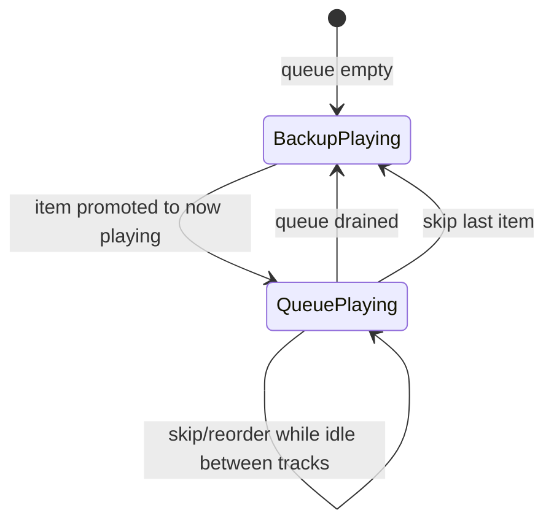

# Playback queue and backup

## Entities

| Entity | Purpose |
|--------|---------|
| **Queue** | Ordered viewer and staff requests; one **now playing** at a time |
| **Backup** | Separate ordered list; plays only when queue has no playable **now playing** and no pending next item |

## Queue item (minimum fields)

| Field | Notes |
|-------|-------|
| `source` | `viewer` \| `staff` |
| `youtube_url` | Normalized single-video URL |
| `title` | From metadata fetch |
| `duration_seconds` | From metadata; display as `mm:ss` or `h:mm:ss` |
| `requester_nick` | Viewer platform nick; staff items use label **Stream** or operator nick |
| `points_charged` | Integer; `0` for staff-added items |
| `kick_redemption_id` | Nullable; set for viewer webhook orders |
| `status` | `pending` \| `queued` \| `playing` \| `played` \| `skipped` \| `failed` \| `rejected` |
| `position` | Sort key within queue |

Staff-added items skip point debit. Viewer items require successful point settlement per `points-economy.md`.

## Operator actions (queue)

- **Pause** / **Resume** current playback
- **Skip** current item → advance per state machine
- **Reorder** via drag-drop or move up/down
- **Remove** item from queue (policy for refund in `points-economy.md`)

## Backup behavior

- When queue becomes empty after a track ends or is skipped, playback continues from **backup** head (loop backup list).
- When a queue item becomes **now playing**, backup cutover follows account `backup_cutover` (`player-overlay-settings.md`): **immediate** hard stop or **finish_current_track** then hand off to the queue item.
- Backup list is editable by owner/mod (add track, add playlist expansion, remove, reorder).

## Playlist ingestion (staff)

- **Playlist URL** expands to multiple queue or backup rows (one row per video) in playlist order.
- Max expansion count and duration limits are constraints in SPEC.md.

## Viewer link rules

- Accept normalized YouTube **watch** and **youtu.be** single-video URLs.
- Reject playlist-only URLs for viewer submissions unless product later allows (non-goal for MVP).

## State machine (simplified)

## Overlay sync

Public overlay and operator UI show the same **now playing** fields: title, duration (elapsed optional), requester nick. Queue depth may be operator-only or also on overlay — default operator-only unless overlay companion extended later.
